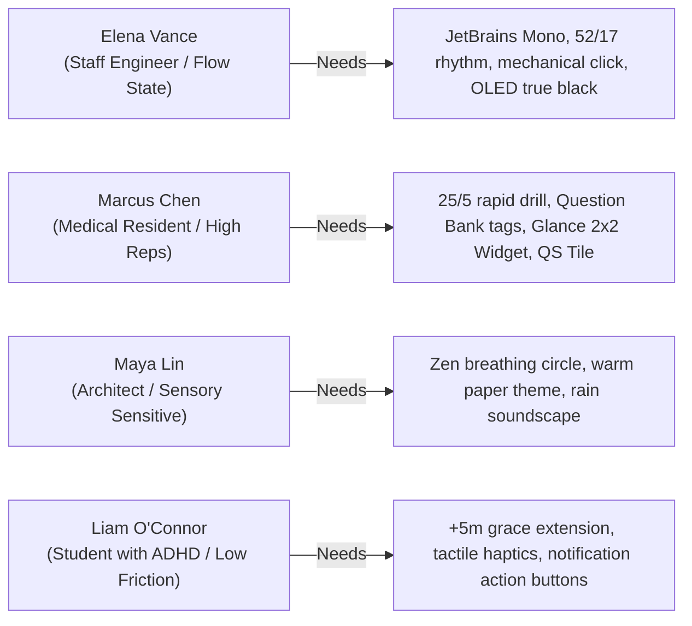

# PRODUCT REQUIREMENTS DOCUMENT (PRD)
## Project: ChronoCraft — Infinitely Customizable Pomodoro App
**Platform:** Android Exclusive (Android 10+ / API 29 through Android 15+, Expo SDK 52+ with Prebuild / New Architecture)  
**Target Audience:** Knowledge workers, software engineers, students, ADHD focus seekers, creative professionals  
**Version:** 1.0.0-ANDROID  
**Document Status:** Approved for Android Engineering Architecture & Sprint Planning  

---

## 1. Executive Summary & Vision

### 1.1 Vision Statement
Most time-management apps enforce a rigid paradigm: either they are barebones 25/5 timers with hardcoded red accents, or bloated gamified productivity tools encumbered by intrusive social feeds and paywalled timer adjustments.

**ChronoCraft** is built on a distinct design philosophy: **Zero Friction, Infinite Personalization, Pure Focus**. Designed exclusively for the Android ecosystem, it is an ultra-minimalist yet 100% customizable interval and focus engine. Users can tailor every dimension of their productivity ritual—from bespoke sequence stages (e.g., 52m Deep Work → 17m Rest → 3m Mobility), audio soundscapes, and clock visuals (Minimalist Digital, 3D Flip, Zen Breathing, Smooth Ring), to custom OLED true-black palettes, Material You (Monet) dynamic color theming, Android Haptic feedback, Quick Settings Tiles, and interactive Jetpack Compose Glance home screen widgets.

### 1.2 Core Value Propositions
1. **Unbounded Sequence Composition:** Transcend the canonical 25/5 Pomodoro with custom stage chains, conditional loops, micro-rest stages, and negative overtime count-up.
2. **Visual & Aesthetic Sovereignty:** Switch seamlessly between a raw Monospace terminal clock, retro 3D flip clock, Zen breathing circle, or smooth SVG ring, skinned with user-defined hex tokens or Android 12+ Material You system colors.
3. **Android-Native Integration:**
   - **Persistent Foreground Service:** Ongoing notification with native system chronometer countdown (`chronometer: { base: targetEndTime, down: true }`) for zero-battery tracking.
   - **Interactive Jetpack Compose Glance Widgets:** Dynamic 2x1, 2x2, and 4x2 home screen widgets with direct play/pause/skip actions.
   - **Quick Settings Tile:** Toggle or check your focus session directly from the Android quick settings drawer.
4. **Hardware-Level Tactile & Acoustic Delight:** Custom mechanical keyboard click ticking, binaural brown noise, curated bell finishes, and bespoke Android `HapticFeedbackConstants` vibrations.
5. **Resilient Local-First Architecture:** The timer engine relies strictly on monotonic epoch offsets (`targetEndTime = startTime + durationMs`). It never loses state if the app is killed by the Android Low Memory Killer (LMK), the phone restarts, or the user crosses time zones.

---

## 2. Target Personas & Detailed User Journeys

### 2.1 Personas



#### Persona 1: Elena Vance — Senior Staff Software Engineer
- **Profile:** 34, remote backend architect working in distributed systems on Google Pixel / ThinkPhone.
- **Pain Point:** Traditional 25m pomodoros shatter her deep flow state while debugging microservices. Standard apps look like brightly colored consumer toys.
- **Needs:** Custom 52-minute "Deep Work" followed by 17-minute "Disconnect". Monospaced typography (`JetBrains Mono`), OLED true-black aesthetic, subtle mechanical blue-switch ticking audio, zero visual distraction.
- **Key Habit:** Runs the app in ambient desk dock mode with Always-On Display (AOD) burn-in protection enabled.

#### Persona 2: Marcus Chen — Medical Resident & USMLE Candidate
- **Profile:** 27, preparing for medical licensing exams during 14-hour hospital shifts using a Samsung Galaxy device.
- **Pain Point:** Needs rigid discipline to smash through 200 flashcards per block. Loses track of which subspecialty he studied throughout the day.
- **Needs:** Color-coded task tags (`#Cardiology`, `#Biochem`), daily goal ring (10 Pomodoros/day target), Jetpack Compose Glance widgets on his home screen, and Quick Settings tile to trigger flashcard blocks without opening the app.
- **Key Habit:** Interacts with ChronoCraft 80% of the time via the Android Ongoing Notification chronometer and Glance home widget.

#### Persona 3: Maya Lin — Architectural Designer & Creative Director
- **Profile:** 29, spends hours in CAD and 3D modeling on a Galaxy Tab & OnePlus phone.
- **Pain Point:** Harsh alarm bells trigger acute sensory stress. Digital numbers cause time anxiety.
- **Needs:** Zen breathing visualizer (organic expanding/contracting circle), soft warm paper background (`#FBF8F2`), Tibetan singing bowl chime, custom 3-minute "Postural Stretch & Eye Rest" stage before each long break.
- **Key Habit:** Relies on continuous ambient brown noise and subtle Android haptic taps.

#### Persona 4: Liam O'Connor — University Student with ADHD
- **Profile:** 21, undergraduate student with executive dysfunction.
- **Pain Point:** Strict timers create task paralysis; feeling forced to stop right when hyperfocus kicks in ruins momentum.
- **Needs:** "+5m Quick Extension" button, Overtime Count-Up (showing surplus focus time rather than terminating abruptly), high-satisfaction haptics, and zero friction to hit "Play" directly from notification actions.

---

### 2.2 End-to-End User Journeys

#### Journey 1: The Deep Work Flow (Elena Vance)
1. **Session Setup:** Elena opens ChronoCraft. The app restores her preset: "Deep Architecture (52m Focus / 17m Break / 4 Cycles)".
2. **Launch:** She taps the center display. The screen drops into OLED black; numbers switch to a dimmer monospaced tabular font; mechanical keyboard clicks tick softly at 1 Hz.
3. **Desk Dock Mode:** She sets her phone on a vertical stand. The screen dims down; 1-pixel micro-shift prevents OLED burn-in.
4. **Completion & Transition:** At 52:00, a low-resonance gong plays. The phone vibrates with a smooth three-pulse haptic. The display gently transitions into a warm emerald tone indicating "Rest & Walk".

#### Journey 2: The Interrupted Focus & Recovery (Liam O'Connor)
1. **Focus in Progress:** Liam is 18 minutes into a 25-minute study block when a roommate asks a question.
2. **Android Notification Control:** Liam swipes down the Android notification shade and taps the **[ ⏸ Pause ]** action button on the ongoing chronometer notification.
3. **Resumption:** 4 minutes later, he taps **[ ▶ Resume ]** right from the notification drawer without launching the app.
4. **Hyperfocus Extension:** At 25:00, the bell sounds, but Liam is mid-sentence in an essay. He hits the **[ ➕ +5m ]** button directly on the notification alert banner.

---

## 3. The "Everything Customizable" Matrix

ChronoCraft parameterizes every single component of the timer lifecycle.

```
┌────────────────────────────────────────────────────────────────────────┐
│                        CHRONOCRAFT ENGINE (ANDROID)                    │
├─────────────────┬──────────────────┬─────────────────┬─────────────────┤
│    SEQUENCES    │     VISUALS      │  AUDIO/HAPTIC   │  THEME/TYPO     │
├─────────────────┼──────────────────┼─────────────────┼─────────────────┤
│ • Custom Stages │ • Digital Clock  │ • Custom Ticks  │ • OLED True Blk │
│ • Arbitrary Min │ • Flip Clock 3D  │ • White/Brown   │ • Material You  │
│ • Loops & Chains│ • Ring Progress  │ • Chimes/Bells  │ • Warm Paper    │
│ • Overtime Count│ • Zen Breath     │ • Custom Vibr.  │ • Cyber Neon    │
│ • Auto-Triggers │ • Minimal Bar    │ • Vol Ducking   │ • Roboto/JetBr  │
└─────────────────┴──────────────────┴─────────────────┴─────────────────┘
```

### 3.1 Durations, Sequences & Stage Flow Engine
- **Custom Stage Chains:** Not limited to Work → Break. Users can create chains like: `Deep Code (50m)` → `Eye Rest (3m)` → `Review (20m)` → `Walk (15m)`.
- **Overtime Mode:** Continue counting up into negative numbers (`-02:14`) so hyperfocus is preserved and logged as bonus productivity.
- **Grace Period Buffer:** Allows short pauses without counting as an "interruption" in analytics.

### 3.2 Timer Visualizations & Animation Engine
1. **Minimalist Digital Clock:** Tabular figures (`Roboto Mono` or `JetBrains Mono`), optional millisecond toggle, optional colon blink.
2. **Circular Ring Progress:** Hardware-accelerated SVG/Skia stroke animation with custom stroke width and rounded endpoints.
3. **Retro 3D Flip Clock:** Mechanical perspective flip cards with realistic shadow gradients and flap mechanics.
4. **Zen Breathing Circle:** Algorithmic expanding/contracting circle tuned to 4-4 or 4-7-8 breathing cadences for anxiety-free focus.
5. **Monochrome Status Line:** Ultra-thin progress line on the edge of the screen for distraction-free peripheral awareness.
- **OLED Burn-in Protection:** Sub-pixel shift every 120s for docked Always-On Display usage.

### 3.3 Audio & Soundscape Engine
- **Ambient Focus Tracks:** Mechanical Blue-Switch Keyboard, Brown Noise, Binaural 40Hz Gamma waves, Summer Rain, Cafe murmur.
- **Gapless Looping:** Implemented via low-latency Android audio streams.
- **Audio Ducking & Headphone Disconnect:** Listens to `AudioManager.ACTION_AUDIO_BECOMING_NOISY` to immediately pause sounds if headphones are unplugged/disconnected.
- **Custom Sound Import:** Import local audio files via the Android Storage Access Framework (SAF).

### 3.4 Android Haptics Engine
- Driven by `Vibrator` / `VibratorManager` and `HapticFeedbackConstants`:
  - `CLOCK_TICK` for subtle second ticks.
  - `CONFIRM` / `GESTURE_END` for stage completions.
  - Custom vibration waveform patterns (`VibrationEffect.createWaveform`) for custom cadences.

### 3.5 Themes & Typography (Material You + Custom)
- **Material You Dynamic Theming:** Automatically extracts user wallpaper palettes (Monet engine) on Android 12+ devices for native integration.
- **Curated Presets:** OLED True Black (`#000000`), Warm Papyrus (`#FBF8F2`), Cyber Neon (`#080B10`), Nordic Pastel, Matcha Calm.
- **Typography:** Android system `Roboto`, `Roboto Flex`, `Roboto Mono`, plus bundled `JetBrains Mono` and `Inter`.
- **WCAG 2.1 Contrast Checker:** Live contrast ratio calculation to prevent unreadable color combinations.

### 3.6 Tasks, Tags & Goals
- Hierarchical tagging (`#coding`, `#writing`, `#study`).
- Daily Pomodoro goals with streak tracking.
- Distraction Scratchpad: Slide down during an active session to drop quick notes without pausing the clock.

### 3.7 Android Notification & Quick Settings System
- **Ongoing Foreground Service Notification:**
  - High-priority, silent channel with persistent countdown using Android native chronometer (`setUsesChronometer(true)`).
  - Action buttons: `[ ⏸ Pause / ▶ Resume ]`, `[ ⏭ Skip ]`, `[ ➕ +5m ]`, `[ ⏹ Stop ]`.
- **Completion Heads-Up Notification:**
  - High-priority sound and vibration alert with actions: `[ Start Break ]`, `[ +5m Grace ]`.
- **Quick Settings Tile (`FocusTileService`):**
  - Add "ChronoCraft" to the Android quick settings tray.
  - Shows current timer status; tap to start/pause session instantly.

### 3.8 Jetpack Compose Glance AppWidgets
- **Small (2x1 / 2x2):** Circular ring progress, time remaining, active task badge.
- **Medium (4x2):** Timer readout, upcoming stage preview, and interactive buttons (`Play/Pause`, `+5m`, `Skip`).
- **Material You Dynamic Colors:** Widgets inherit system colors on Android 12+.

---

## 4. Technical Architecture (Android)
- **React Native Stack:** Expo SDK 52+ Prebuild (Continuous Native Generation - CNG) with New Architecture (Fabric + TurboModules).
- **Zero-Drift Timestamp Protocol:**
  $$\text{targetEndTime} = \text{startTime} + \text{durationMs}$$
  $$\text{remainingMs} = \max(0, \text{targetEndTime} - \text{Date.now()})$$
- **State Management:** Zustand backed by multi-process MMKV (`MMKV.MULTI_PROCESS_MODE`) for instant synchronization between the main UI, background services, and Glance widgets.
- **Telemetry DB:** Local SQLite (`expo-sqlite`) for historical session logging, heatmap generation, and streak tracking.

---

## 5. Non-Functional Requirements & Resilience
- **Cold App Launch:** $< 350\text{ms}$ on Android 12+ mid-range devices.
- **Frame Rate:** Pinned 60/120 FPS via Reanimated worklets on the UI thread.
- **Battery Optimization:** $< 1.5\%$ battery drain over 4 hours using native Android Chronometer.
- **Doze Mode & Low Memory Killer (LMK):** Alarms scheduled via `AlarmManager.setExactAndAllowWhileIdle()` with `SCHEDULE_EXACT_ALARM`.
- **Device Reboot:** BroadcastReceiver for `ACTION_BOOT_COMPLETED` automatically checks MMKV and reschedules pending session alarms.
- **Privacy:** 100% offline, zero tracking, optional private backup to user's Google Drive.
