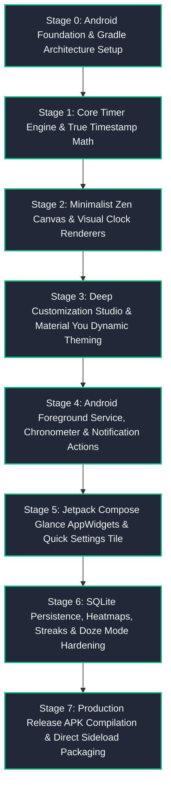

# STAGES & EXECUTION ROADMAP: ChronoCraft Pomodoro (Android)

**Platform:** Android Exclusive (Android 10+ / API 29 through Android 15+, Expo SDK 52+ with Prebuild, New Architecture)  
**Deliverable Status:** Master Project Stages, Engineering Milestones & Quality Gates  
**Methodology:** Phased, risk-first agile development with continuous Android native compilation verification.

---

## Stage Breakdown Overview

---

## Detailed Breakdown of App Stages (Android)

### Stage 0: Android Foundation & Gradle Architecture Setup
- **Goal:** Establish a robust React Native foundation configured for Continuous Native Generation (CNG) targeting Android, with New Architecture and Kotlin TurboModules enabled.
- **Key Tasks:**
  1. Initialize Expo SDK 52+ with TypeScript template and New Architecture enabled (`newArchEnabled=true` in `gradle.properties`).
  2. Configure ESLint, Prettier, TypeScript strict mode, and path aliases (`@/components`, `@/store`, `@/services`, `@/theme`, `@/widgets`).
  3. Configure Android Gradle plugins, ProGuard/R8 minification rules, and Android 14/15 edge-to-edge support.
  4. Install and configure `react-native-mmkv` with `MULTI_PROCESS_MODE` verified.
  5. Set up local Android emulator and physical device debugging harnesses via ADB.
- **Deliverables:**
  - Compiling Android baseline application with JSI/Fabric verified.
  - Reproducible `npx expo prebuild --platform android` workflow.
- **Gate Criteria:** Zero TypeScript errors; clean `./gradlew assembleDebug` execution; sub-300ms baseline cold launch.

---

### Stage 1: Core Zero-Drift Timer Engine
- **Goal:** Build the single-source-of-truth mathematical timer engine that never drifts, handles pause/resume/extend, and survives Android Low Memory Killer (LMK) process termination.
- **Key Tasks:**
  1. Implement the Epoch Target Timestamp math:
     - `targetEndTime = startTime + durationMs`
     - `remainingMs = max(0, targetEndTime - Date.now())`
  2. Build the finite state machine (`IDLE`, `RUNNING`, `PAUSED`, `STAGE_COMPLETED`) using Zustand.
  3. Implement pause delta calculation (`remainingMsAtPause`) and resume target recalculation.
  4. Create the cycle sequencer (Pomodoro → Short Break → Pomodoro → Long Break or custom chain).
  5. Implement `AppState` listener reconciler:
     - On foregrounding (`active`), compare `Date.now()` with `targetEndTime` and auto-reconcile state.
  6. Add unit test suite for time-warp conditions (Doze mode, background suspension, time zone changes).
- **Deliverables:**
  - Headless `@/store/useTimerStore.ts` with 100% test coverage.
  - Complete state transition validation harness.
- **Gate Criteria:** Zero millisecond drift after simulated background freeze in unit tests.

---

### Stage 2: Minimalist Zen Canvas & Visual Clock Renderers
- **Goal:** Create the distraction-free "Zen Canvas" with modular, swappable visual clock renderers optimized for Android displays.
- **Key Tasks:**
  1. Implement the primary **Zen Canvas** screen with distraction-free layout (fading controls after 3s).
  2. Build the 4 interchangeable clock visualizers:
     - **Circular SVG Ring:** GPU-accelerated stroke-dashoffset animation via `react-native-reanimated` worklet.
     - **Digital Flip Clock:** 3D perspective card flip with split upper/lower flaps.
     - **Minimalist Sandglass:** Particle physics or geometric hourglass depletion.
     - **Zen Breathing Orb:** Sinusoidal scale expansion/contraction for mindfulness breaks.
  3. Implement fluid gesture system using `react-native-gesture-handler`:
     - Single tap to start/pause.
     - Double tap to add +5 minutes.
     - Swipe right to skip/complete stage.
     - Pull down for pure fullscreen OLED black mode.
     - Swipe up to reveal Quick Adjust drawer.
- **Deliverables:**
  - Interactive, fluid timer UI running strictly on the UI thread (60/120 FPS).
  - Quick Adjust bottom sheet drawer (`@gorhom/bottom-sheet`).
- **Gate Criteria:** UI thread frame rate stays pinned at 60/120 FPS during active animation on Android devices.

---

### Stage 3: Deep Customization Studio & Material You Dynamic Theming
- **Goal:** Deliver the "infinite customization" matrix with native Material You (Monet) dynamic color palette integration.
- **Key Tasks:**
  1. **Timer Rules Studio:** Custom stage creation, duration pickers (1 to 120 min), custom stage sequences (e.g. Deep Work → Stretch → Review), auto-start triggers.
  2. **Theme Token Studio:**
     - Material You dynamic theming: Extract wallpaper color tokens on Android 12+ devices (`@react-native-material/core` or custom native palette extraction).
     - Curated presets (OLED Obsidian, Warm Papyrus, Cyber Neon, Matcha Calm).
     - Custom hex palette editor with WCAG 2.1 AAA contrast checker.
  3. **Typography Engine:** Font loader supporting `Roboto`, `Roboto Mono`, and bundled `JetBrains Mono`.
  4. **Audio & Sensory Pipeline:**
     - Low-latency ticking sounds (mechanical keyboard click, clock tick, heart pulse, mute).
     - Gapless ambient noise generators (rain, cafe, white/brown noise, 40Hz binaural beats).
     - Android `HapticFeedbackConstants` for tactile feedback (`CLOCK_TICK`, `CONFIRM`, `LONG_PRESS`).
- **Deliverables:**
  - Focus Studio settings modal with modular bento sections.
  - Soundscape player module with audio ducking and `ACTION_AUDIO_BECOMING_NOISY` listener.
- **Gate Criteria:** Instantaneous theme switching (<50ms) with zero UI re-mount flicker; seamless gapless ambient audio looping.

---

### Stage 4: Android Foreground Service, Chronometer & Notification Actions
- **Goal:** Engineer an exact, actionable local notification system and foreground service that operates with zero battery waste.
- **Key Tasks:**
  1. Integrate `@notifee/react-native` with exact alarm permission (`SCHEDULE_EXACT_ALARM` / `USE_EXACT_ALARM`).
  2. Configure Android Notification Channels:
     - Channel 1: `pomodoro_ongoing` (Low importance, silent, persistent chronometer).
     - Channel 2: `pomodoro_completion` (High importance, heads-up sound & vibration).
  3. Android Foreground Service:
     - Ongoing notification with native chronometer countdown (`chronometer: { base: targetEndTime, down: true }`).
     - Action buttons: `[ ⏸ Pause / ▶ Resume ]`, `[ ⏭ Skip ]`, `[ ➕ +5m ]`, `[ ⏹ Stop ]`.
  4. Headless background event listener (`notifee.onBackgroundEvent`):
     - Handle "+5 min" or "Start Break" directly from lock screen/notification shade while app is killed.
     - Update multi-process MMKV storage directly without mounting the full React tree.
- **Deliverables:**
  - Notification manager service (`@/services/notificationService.ts`).
  - Headless background event handler (`index.js`).
- **Gate Criteria:** Notifications trigger with ±0.5s precision at timer expiration; action buttons update timer state when app process is dead.

---

### Stage 5: Jetpack Compose Glance AppWidgets & Quick Settings Tile
- **Goal:** Bring real-time countdowns and quick-start actions directly to the Android home screen and notification shade.
- **Key Tasks:**
  1. **Jetpack Compose Glance AppWidgets:**
     - Build Small widget (2x1 / 2x2): Progress circle + time remaining + active task.
     - Build Medium widget (4x2): Timer countdown + upcoming stage preview + interactive action buttons (`Play/Pause`, `+5m`, `Skip`).
     - Support Android 12+ dynamic theming via `GlanceTheme`.
  2. **Multi-Process Widget Sync:**
     - Read state directly from multi-process MMKV (`MMKV.MULTI_PROCESS_MODE`).
     - Trigger `AppWidgetManager.notifyAppWidgetViewDataChanged()` upon timer mutations.
  3. **Android Quick Settings Tile (`FocusTileService`):**
     - Add tile to Android quick settings drawer.
     - Displays live status (Active / Inactive) and remaining minutes; tap toggles focus session.
- **Deliverables:**
  - Jetpack Compose Glance widget provider implementation.
  - Android `FocusTileService` Quick Settings implementation.
  - Native module bridge (`@/widgets/WidgetBridge.ts`).
- **Gate Criteria:** Home screen widget updates within 5ms of timer state mutation; Quick Settings tile toggles timer seamlessly.

---

### Stage 6: SQLite Persistence, Heatmaps, Streaks & Doze Mode Hardening
- **Goal:** Implement task tagging, daily goal tracking, local-first analytics, and comprehensive Android edge-case handling.
- **Key Tasks:**
  1. Set up Expo SQLite for historical session telemetry:
     - Sessions table (timestamp, duration, stage, tag, completed, interruptions).
     - Tags table (name, color, icon, target weekly hours).
  2. Build Analytics dashboard:
     - GitHub-style annual focus heatmap.
     - Daily/weekly hourly distribution bar charts.
     - Streak counter and best streak tracking.
  3. Android Edge Case Hardening:
     - Device reboot recovery: BroadcastReceiver for `ACTION_BOOT_COMPLETED` checks MMKV and reschedules pending alarms.
     - Battery Saver / Doze mode resilience via `AlarmManager.setExactAndAllowWhileIdle()`.
     - Time zone transition safety: Timestamps stored in UTC epoch milliseconds.
- **Deliverables:**
  - Analytics & History screen with interactive charts.
  - Full local SQLite database layer with migration support.
- **Gate Criteria:** 10,000 session query performance benchmark under 15ms; graceful handling of phone restarts and timezone switches.

---

### Stage 7: Production Release APK Compilation & Direct Sideload Packaging
- **Goal:** Finalize production builds, configure APK signing, optimize runtime byte-code, and compile a standalone, installable Release APK (`.apk`) ready for direct sideloading and offline use without Google Play Store dependencies.
- **Key Tasks:**
  1. Accessibility audit: Screen reader (TalkBack) labels on all controls, high-contrast theme compliance (WCAG AAA), reduced motion setting support.
  2. Android Release Signing Keystore:
     - Generate secure local release keystore (`release.keystore`).
     - Configure `signingConfigs.release` in `android/app/build.gradle`.
  3. ProGuard/R8 & APK Size Optimization:
     - Enable `minifyEnabled true` and `shrinkResources true`.
     - Configure custom ProGuard rules for Reanimated, Skia, MMKV, and Glance widgets.
     - Configure APK generation: Build both a Universal APK (installs on any device) and ABI-split APKs (optimized for `arm64-v8a`, `armeabi-v7a`, `x86_64`) for minimal download size.
  4. Build Standalone Release APK:
     - Execute `./gradlew assembleRelease` to output signed standalone APKs (`app-release.apk`).
  5. Direct Sideload & Physical Hardware Verification:
     - Sideload APK directly onto physical Android hardware via `adb install -r android/app/build/outputs/apk/release/app-release.apk` and direct file download.
     - Verify 100% offline self-containment (zero Google Play Services runtime dependencies).
- **Deliverables:**
  - Production-ready signed standalone Release APK (`app-release.apk` / Universal & ABI-optimized).
  - Reproducible single-command APK build script (`npm run build:apk`).
- **Gate Criteria:** Clean standalone installation on Android 10 through Android 15 devices; cold startup under 300ms; total APK size <25MB; zero crash reports in stress testing.

---

## Stage Timeline & Milestone Verification Matrix

| Stage | Focus Area | Primary Artifacts | Verification Method |
|---|---|---|---|
| **Stage 0** | Tooling & Setup | Expo SDK 52, TypeScript, MMKV, Android CNG | `./gradlew assembleDebug` clean compile |
| **Stage 1** | Timer Engine | State machine, target timestamp math, unit tests | Jest tests for background suspensions & drift |
| **Stage 2** | Minimal Zen Canvas | Zen canvas, 4 visual clocks, gesture handling | Reanimated performance profiling (60/120 FPS) |
| **Stage 3** | Deep Customization | Soundscape engine, Material You tokens, typography | Real-time audio crossfading & instant theme swaps |
| **Stage 4** | Notifications & Service | Notifee foreground service, chronometer, actions | Verification on locked physical Android devices |
| **Stage 5** | Glance Widgets & Tile | Jetpack Compose Glance widgets, Quick Settings Tile | Interactive home screen widget testing & QS Tile toggle |
| **Stage 6** | Analytics & Hardening | SQLite database, GitHub-style heatmaps, edge cases | Device reboot recovery & 10k session query benchmark |
| **Stage 7** | Release APK Build | Signed standalone Release APK (`.apk`), ABI splits | Direct sideload via `adb install` on physical device |
