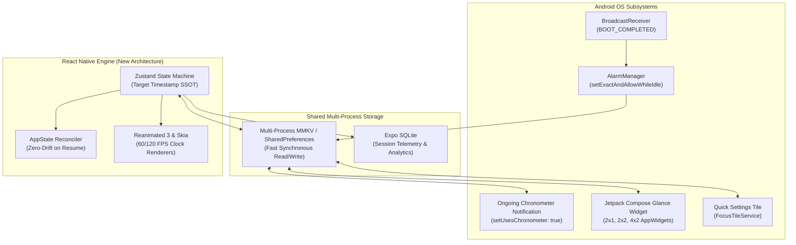

# Technical Architecture Specification: Customizable React Native Pomodoro App (Android)

**Platform:** Android Exclusive (Android 10+ / API 29 through Android 15+, Expo SDK 52+ with Prebuild, New Architecture)  
**Architecture Paradigm:** Local-First, Monotonic Timestamp Single-Source-of-Truth, Multi-Process Native Sync  
**Document Status:** Approved for Engineering Implementation  

---

## 1. Executive Summary & Android Stack Selection

Chrono is engineered as a high-performance, battery-efficient, Android-native productivity engine built on React Native.



### Stack Components
- **Framework:** **React Native 0.76+** with **Expo SDK 52+** using **Continuous Native Generation (CNG)** (`expo prebuild`).
- **Engine:** **New Architecture** enabled (Fabric renderer + TurboModules via Kotlin/C++ JSI).
- **Widgets:** **Jetpack Compose Glance** (`androidx.glance.appwidget`) for declarative, Material You responsive home screen widgets.
- **Background Execution:** Android **Foreground Service** with system Chronometer API (`setUsesChronometer(true)`).
- **Notifications & Alarms:** `@notifee/react-native` + Android `AlarmManager` with `SCHEDULE_EXACT_ALARM`.
- **Fast Storage:** `react-native-mmkv` in `MULTI_PROCESS_MODE` for instantaneous sub-millisecond sync across the React Native UI process, widget processes, and background services.
- **Relational Storage:** `expo-sqlite` for historical session queries, streaks, and heatmaps.
- **Audio Engine:** `react-native-track-player` / `expo-av` with proper Android AudioFocus and `ACTION_AUDIO_BECOMING_NOISY` handlers.

---

## 2. The Background Timer Problem & True Timestamp Architecture

### 2.1 Why `setInterval` Fails on Android
1. **Doze Mode & App Standby:** In Android 6.0+, Doze throttles background execution into infrequent maintenance windows (sometimes 10–15 minutes apart). JavaScript `setInterval` callbacks stop firing.
2. **Low Memory Killer (LMK):** When the user switches to heavy apps (cameras, games), Android terminates background processes without warning. Any decrementing in-memory variable (`secondsLeft--`) is wiped out.
3. **Timer Drift:** Standard timers experience CPU drift under thermal throttling.

### 2.2 Mathematical Target Timestamp Pattern (SSOT)
The application completely discards decrementing state loops (`secondsLeft--`). Instead, the Single Source of Truth (SSOT) is an absolute epoch timestamp:

$$\text{targetEndTime} = \text{startTime} + \text{durationMs}$$
$$\text{remainingMs} = \max(0, \text{targetEndTime} - \text{Date.now()})$$

### 2.3 State Transitions & Reconciler
- **Running:** Store records `targetEndTime`. `remainingMs` is derived in real time.
- **Pause:**
  $$\text{remainingMsAtPause} = \max(0, \text{targetEndTime} - \text{Date.now()})$$
  Delete `targetEndTime`.
- **Resume:**
  $$\text{targetEndTime} = \text{Date.now()} + \text{remainingMsAtPause}$$
  Delete `remainingMsAtPause`.
- **Extend (+5 min):**
  If running: `targetEndTime += 300,000`. Update foreground notification chronometer base and pending alarms.
  If paused: `remainingMsAtPause += 300,000`.
- **Skip:** Immediately advance to the next stage in the sequence.

### 2.4 Foreground Tick Loop
- **UI Animation (60/120 FPS):** Driven by `react-native-reanimated` worklet running directly on the UI thread (`useFrameCallback` / interpolate against `Date.now()`), avoiding any JS thread bottlenecks.
- **Digital MM:SS Display:** Decoupled 1-second tick hook.
- **Zero-Drift AppState Reconciler:** When `AppState` transitions from `background` to `active`, the reconciler compares `Date.now()` with `targetEndTime`. If `Date.now() >= targetEndTime`, it fires the stage completion transition immediately.

---

## 3. Android Notification & Background Services Architecture

### 3.1 Foreground Service & Ongoing Notification
When a timer starts, Chrono triggers an Android Foreground Service with an ongoing notification in a dedicated notification channel:

```typescript
import notifee, { AndroidImportance, AndroidColor } from '@notifee/react-native';

export async function startTimerForegroundService(targetEndTime: number, stageName: string) {
  const channelId = await notifee.createChannel({
    id: 'pomodoro_ongoing',
    name: 'Active Focus Timer',
    importance: AndroidImportance.LOW, // Silent, non-intrusive
  });

  await notifee.displayNotification({
    id: 'ongoing_timer',
    title: `Focus: ${stageName}`,
    body: 'Session in progress',
    android: {
      channelId,
      asForegroundService: true,
      ongoing: true,
      color: AndroidColor.GREEN,
      chronometer: {
        base: targetEndTime,
        down: true, // Native Android countdown clock!
      },
      actions: [
        { title: '⏸ Pause', pressAction: { id: 'ACTION_PAUSE' } },
        { title: '⏭ Skip', pressAction: { id: 'ACTION_SKIP' } },
        { title: '➕ +5m', pressAction: { id: 'ACTION_EXTEND_5M' } },
      ],
    },
  });
}
```
**Key Advantage:** The Android System UI manages the chronometer display directly on-chip with **zero JavaScript thread execution and near-zero battery drain**.

### 3.2 Exact Completion Alarm
Simultaneously, Chrono schedules an exact trigger alert for when `targetEndTime` is reached:
- Uses `SCHEDULE_EXACT_ALARM` / `USE_EXACT_ALARM` permissions via Android `AlarmManager`.
- Fires a high-importance completion notification with sound, vibration, and actionable buttons: `[ Start Break ]`, `[ +5m Grace ]`.

### 3.3 Headless Background Action Handling
Action button presses in the notification drawer dispatch events to `notifee.onBackgroundEvent`:
```typescript
notifee.onBackgroundEvent(async ({ type, detail }) => {
  if (detail.pressAction?.id === 'ACTION_EXTEND_5M') {
    const storage = getMultiProcessMMKV();
    const currentTarget = storage.getNumber('targetEndTime') || Date.now();
    const newTarget = currentTarget + 300000;
    storage.set('targetEndTime', newTarget);

    // Update ongoing notification chronometer without waking full React UI
    await updateOngoingNotificationChronometer(newTarget);
    // Broadcast update to Jetpack Compose Glance widgets
    WidgetBridge.notifyWidgetsDataChanged();
  }
});
```

---

## 4. Jetpack Compose Glance AppWidget Architecture

### 4.1 Glance Declarative UI
Using Android Jetpack Compose Glance (`androidx.glance.appwidget`), widgets are built declaratively with full support for Android 12+ Material You dynamic theming (`GlanceTheme`).

```kotlin
// Android Jetpack Compose Glance Widget implementation
class ChronoWidget : GlanceAppWidget() {
    override suspend fun provideGlance(context: Context, id: GlanceId) {
        val mmkv = MMKV.mmkvWithID("pomodoro_shared", MMKV.MULTI_PROCESS_MODE)
        val stageName = mmkv.decodeString("currentStageName", "Focus")
        val targetEndTime = mmkv.decodeLong("targetEndTime", 0L)
        val isRunning = mmkv.decodeBool("isRunning", false)

        provideContent {
            GlanceTheme {
                WidgetLayout(stageName, targetEndTime, isRunning)
            }
        }
    }
}
```

### 4.2 Widget Sizes & Capabilities
1. **Small (2x1 / 2x2):** Stage title, remaining minutes, progress ring, single tap to deep-link into app.
2. **Medium (4x2):** Full timer countdown display, active task name, and interactive buttons (`Play/Pause`, `+5m`, `Skip`) powered by Glance `ActionCallback`.

### 4.3 Multi-Process Sync Bridge
- **Storage:** `react-native-mmkv` running in `MULTI_PROCESS_MODE`.
- **Broadcast:** When state changes in React Native, a native module triggers `AppWidgetManager.notifyAppWidgetViewDataChanged()`, refreshing the Glance widgets within 5 milliseconds.

---

## 5. Android Quick Settings Tile (`FocusTileService`)

Chrono provides an Android Quick Settings Tile so users can manage their focus session directly from the pull-down shade without opening the application:

```kotlin
class FocusTileService : TileService() {
    override fun onStartListening() {
        val mmkv = MMKV.mmkvWithID("pomodoro_shared", MMKV.MULTI_PROCESS_MODE)
        val isRunning = mmkv.decodeBool("isRunning", false)
        
        qsTile.state = if (isRunning) Tile.STATE_ACTIVE else Tile.STATE_INACTIVE
        qsTile.label = if (isRunning) "Focusing..." else "Start Focus"
        qsTile.updateTile()
    }

    override fun onClick() {
        val mmkv = MMKV.mmkvWithID("pomodoro_shared", MMKV.MULTI_PROCESS_MODE)
        val isRunning = mmkv.decodeBool("isRunning", false)
        
        if (isRunning) {
            TimerServiceController.pauseTimer(this)
        } else {
            TimerServiceController.startTimer(this, 25 * 60 * 1000L)
        }
    }
}
```

---

## 6. Android Edge Cases & Resilience

1. **Device Reboot (`ACTION_BOOT_COMPLETED`):**
   - Registered `BroadcastReceiver` wakes on boot.
   - Reads `targetEndTime` from MMKV. If the timer was running and has not expired, it reschedules the exact completion alarm and restarts the ongoing notification chronometer.
2. **Battery Optimization Exemptions:**
   - App provides a graceful prompt directing users to disable aggressive manufacturer battery killers (Samsung sleeping apps, Xiaomi MIUI battery savers) via `Settings.ACTION_REQUEST_IGNORE_BATTERY_OPTIMIZATIONS`.
3. **Headphones Disconnection:**
   - Registers `AudioManager.ACTION_AUDIO_BECOMING_NOISY` to immediately pause ambient background noise if Bluetooth or wired headphones are disconnected.
4. **Time Zone & Daylight Savings Changes:**
   - All calculations use monotonic epoch timestamps (`System.currentTimeMillis()`), completely unaffected by timezone changes.
